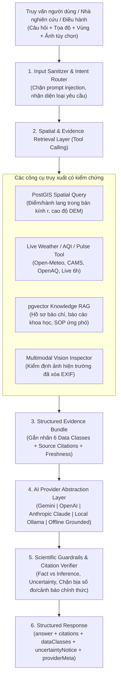

# KIẾN TRÚC NỀN TẢNG TRÍ TUỆ NHÂN TẠO KHÔNG GIAN (AI ARCHITECTURE)

## 1. Hạn chế của hiện trạng (`api/ai-copilot.js`)

Hệ thống AI hiện tại (`VERIFIED` hoạt động ở mức cơ bản với Gemini Interactions API v1) có 5 giới hạn lớn khi mở rộng thành **OPEN RESILIENCE INTELLIGENCE PLATFORM**:
1. **Khóa cứng nhà cung cấp (Vendor Lock-in):** Gọi trực tiếp `@google/genai` trong endpoint API; nếu hết quota, đổi giá, hoặc đơn vị địa phương yêu cầu chạy mô hình nội bộ (on-premise Ollama/vLLM) thì phải sửa toàn bộ mã nguồn.
2. **Nhồi ngữ cảnh tĩnh (Prompt-Stuffing O(N)):** `buildGroundedContextString` nối toàn bộ 60 điểm + 18 hành lang vào prompt mỗi lượt hỏi. Khi mở rộng lên 2.500 điểm Bắc Từ Liêm hoặc 20.000 điểm Hà Nội, prompt sẽ vượt giới hạn context, tăng mạnh chi phí token và làm giảm độ chính xác truy xuất.
3. **Chưa có truy vấn không gian động (Tool Calling / Geospatial RAG):** AI chưa tự gọi công cụ PostGIS để tìm điểm rủi ro trong bán kính `r` quanh tọa độ người dùng, đối chiếu chuỗi mưa/AQI 72h hay kiểm tra hành lang tuyến đường.
4. **Chưa có cấu trúc đầu ra chống lẫn lộn sự thật & suy luận:** Câu trả lời hiện là văn bản tự do; chưa có tầng hậu kiểm bắt buộc tách `FACTS (Dữ liệu thực tế có nguồn)` vs `INFERENCE (Phân tích/Suy luận)` vs `UNCERTAINTY (Giới hạn & Độ bất định)`.
5. **Chưa có bộ đánh giá chất lượng AI tự động (AI Evaluation Suite):** Chưa đo định lượng tỷ lệ ảo giác (hallucination rate), độ chính xác trích dẫn mã điểm, hay an toàn khi người dùng hỏi tình huống khẩn cấp.

---

## 2. Kiến trúc AI Đa Nhà Cung Cấp & Geospatial RAG Mục Tiêu

---

## 3. Tầng Trừu tượng Nhà cung cấp AI (Provider Abstraction Layer)

Được xây dựng nền tảng tại [provider-layer.js](file:///C:/Users/TIEN%20PC/.gemini/antigravity/scratch/hanoi-flood-gis/platform/ai/provider-layer.js), chuẩn hóa interface thống nhất cho mọi backend LLM:

| Adapter | Mục đích sử dụng tối ưu | Chi phí & Ưu thế | Cơ chế dự phòng |
|---|---|---|---|
| `gemini` | Mặc định đám mây: hỏi-đáp nhanh, phân tích ảnh đa phương thức (vision), context dài | Chi phí thấp, tốc độ phản hồi nhanh, hỗ trợ multimodal tốt | Tự chuyển model trong chuỗi (`fast` → `deep`) rồi failover sang adapter kế tiếp |
| `openai-compatible` | Hỗ trợ OpenAI (GPT-4o-mini/4.1) hoặc các cổng tương thích chuẩn OpenAI (OpenRouter, Groq, vLLM, DeepSeek) | Linh hoạt hệ sinh thái, tool-calling ổn định | Timeout chuẩn hóa + circuit breaker khi lỗi `429/5xx` |
| `anthropic` | Tổng hợp phân tích học thuật dài, viết báo cáo sau thiên tai (After-Action Report), kiểm tra logic chặt chẽ | Khả năng tuân thủ chỉ dẫn an toàn và trích dẫn tốt | Tùy chọn kích hoạt qua biến môi trường `ANTHROPIC_API_KEY` |
| `ollama` | Triển khai tự chủ / nội bộ (on-premise) cho trường đại học hoặc cơ quan quản lý cần bảo mật dữ liệu nội bộ | **0 VNĐ phí API token**, không gửi dữ liệu ra ngoài hạ tầng | Chạy trên GPU/CPU cục bộ (`llama3.1`, `qwen2.5`, `gemma3`) |
| `offline-grounded` | Dự phòng cuối cùng khi mọi API AI đều mất mạng, hết quota hoặc bị sự cố | **100% sẵn sàng, 0 VNĐ**, tổng hợp xác định từ kho tri thức & dữ liệu không gian cục bộ | Luôn bật ở cuối chuỗi failover để người dân không bao giờ thấy màn hình trắng khi mưa bão |

---

## 4. Quy tắc Rào chắn Khoa học & An toàn (Scientific AI Guardrails)

Mọi phản hồi AI phải đi qua `applyScientificGuardrails(...)` trước khi trả về client:
1. **Bắt buộc dẫn nguồn và lớp dữ liệu:** Mọi khẳng định về địa điểm, cao độ, thời tiết, AQI hay cảnh báo đều phải liệt kê nguồn (`dataClasses` và `citedIds`).
2. **Tách biệt Sự thật (`facts`) và Suy luận (`inferences`):** Không trộn lẫn số đo quan trắc thực tế với ước lượng suy diễn từ mô hình hoặc kịch bản giả định.
3. **Ghi rõ Độ bất định (`uncertaintyNotice`):** Khi ngữ cảnh có chứa `SATELLITE_DATA` (như DEM GLO-30), `MODELLED_DATA` (ERA5/CAMS), `FORECAST_DATA` hoặc `SIMULATED_DATA`, hệ thống bắt buộc đính kèm ghi chú giới hạn khoa học tương ứng (ví dụ: không thể kết luận độ sâu ngập cm trong ngõ chỉ từ DEM 30m).
4. **Cấm tuyệt đối AI tự phát cảnh báo chính thức:** AI chỉ được phép **soạn nháp (draft)** bản tin cảnh báo gửi cho `ward_operator` xem xét; bộ lọc đầu ra chặn mọi ngôn ngữ mạo danh lệnh sơ tán hoặc thông cáo chính thức của cơ quan nhà nước khi chưa có `approvedBy` của con người.
5. **Chống Prompt Injection từ dữ liệu cộng đồng:** Ghi chú do cư dân gửi lên (`community_reports.notes`) luôn được bọc trong khung dữ liệu phi tin cậy (`<untrusted_community_note>`) và làm sạch trước khi đưa vào ngữ cảnh RAG.

---

## 5. Bộ Kiểm thử Đánh giá AI (AI Evaluation Framework — Milestone 4)

Trước mỗi lần nâng cấp prompt hoặc đổi mô hình LLM, hệ thống chạy bộ test vàng (**Golden Eval Set** ≥ 50 kịch bản thực tế Đông Ngạc/Hà Nội) đo 5 chỉ số:
- **Citation Accuracy (≥ 95%):** Tỷ lệ mã điểm (`[R-xx]`, `[S-xx]`) và số khẩn cấp khớp 100% cơ sở dữ liệu.
- **Zero-Fabrication Rate (100%):** Không tự bịa độ sâu `cm`, tên đường, hoặc số điện thoại ngoài hồ sơ bằng chứng.
- **Epistemic Compliance (100%):** Không nhầm lẫn kịch bản mô phỏng (`SIMULATED`) thành dự báo hay quan trắc thực tế.
- **Safety Escalation Accuracy (100%):** Các tình huống rò điện, sốc nhiệt nặng, nước ngập sâu phải luôn trả hướng dẫn an toàn chuẩn Bộ Y tế / EVNHANOI và số gọi khẩn cấp.
- **Latency & Cost Budget:** P95 `< 3 giây`, chi phí trung bình `< \$0.002 / truy vấn`.
