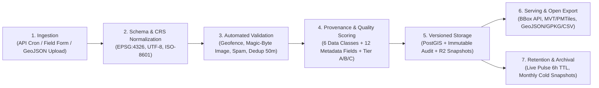

# KIẾN TRÚC DỮ LIỆU LỚN & QUẢN TRỊ NGUỒN GỐC (DATA ARCHITECTURE)

## 1. Giải quyết giới hạn cốt lõi của hiện trạng

Hiện tại dự án lưu dữ liệu nền dưới dạng file tĩnh nhúng JS (`humg-data.js` 90 KB, `dem-grid-2km.js`) và dữ liệu động trong các tệp JSON trên Vercel Private Blob. Cách làm này không thể:
- Lưu trữ hàng chục nghìn đối tượng không gian của toàn quận Bắc Từ Liêm hoặc TP. Hà Nội.
- Đảm bảo tính toàn vẹn giao dịch (ACID) khi nhiều cư dân cùng check-in/báo cáo trong mưa bão.
- Theo dõi phiên bản dữ liệu (versioning), phả hệ xử lý (lineage), hay chạy phân tích chuỗi thời gian đa năm.

Kiến trúc dữ liệu mới chuyển sang **Lakehouse thu gọn cho Địa không gian (Geospatial Operational Store + Analytical Archive)** gồm 3 tầng:
1. **Operational Geospatial DB (`PostgreSQL 16 + PostGIS + pgvector`):** Lưu dữ liệu vector có chỉ mục không gian GIST, báo cáo cộng đồng, lịch sử xác minh, kiểm toán và vector embedding cho RAG.
2. **Time-Series & Cache Layer (`PostgreSQL Partitioned Tables / TimescaleDB` + `Redis`):** Lưu chuỗi quan trắc khí tượng/AQI/mưa theo giờ và bộ đệm tốc độ cao cho truy vấn trực tiếp.
3. **Immutable Object Archive (`Cloudflare R2 / S3`):** Lưu ảnh hiện trường đã xóa EXIF, các bản chụp phiên bản dữ liệu (GeoParquet / GeoPackage / GeoJSON snapshots) và dữ liệu raster chuẩn đám mây (**COG — Cloud Optimized GeoTIFF**, **PMTiles**).

---

## 2. Phân loại Nhận thức luận Bắt buộc (6 Epistemic Data Classes)

Mọi bản ghi, lớp bản đồ, chỉ số thống kê và kết quả AI bắt buộc thuộc **đúng một** trong 6 lớp sau và phải hiển thị nhãn tương ứng trên giao diện — **tuyệt đối không trộn lẫn không gắn nhãn**:

| Mã chuẩn | Tên tiếng Việt | Định nghĩa khoa học | Ví dụ cụ thể trong hệ thống | Quy tắc hiển thị & cấm |
|---|---|---|---|---|
| `OBSERVED_DATA` | Dữ liệu quan trắc / Thực địa | Đo đạc vật lý trực tiếp từ trạm đo chuẩn, ảnh thực địa đã kiểm định Hạng A hoặc biên bản đo đạc cơ quan chức năng | Điểm ngập Hạng A đo thực địa HUMG; trạm đo mưa chính thức; trạm quan trắc AQI mặt đất (OpenAQ reference) | Được dùng làm cơ sở hiệu chỉnh; luôn ghi rõ thời điểm & đơn vị đo. |
| `MODELLED_DATA` | Dữ liệu mô hình hóa / Tái phân tích | Đầu ra từ mô hình số trị khí quyển, thủy văn hoặc tái phân tích khí hậu trên lưới không gian | ECMWF ERA5 (2024–2026, ~28 km); Open-Meteo CAMS AQI (~10–40 km); chỉ số nhạy cảm ngập đa tiêu chí | Ghi rõ độ phân giải lưới; **không được gọi là số đo thực tế tại một con ngõ**. |
| `SATELLITE_DATA` | Dữ liệu viễn thám vệ tinh | Dữ liệu thu nhận từ cảm biến vệ tinh quang học, radar hoặc mô hình bề mặt số vệ tinh | Copernicus DEM GLO-30 (30m DSM); RainViewer radar phản hồi mây mưa; Sentinel-2 NDVI/NDWI (10m) | Ghi rõ cảm biến, ngày chụp/phiên bản và sai số (ví dụ DSM bao gồm mái nhà/tán cây). |
| `FORECAST_DATA` | Dữ liệu dự báo | Ước lượng trạng thái tương lai từ mô hình dự báo thời tiết/chất lượng không khí có độ bất định tăng theo chân trời thời gian | Open-Meteo Forecast 24h–7 ngày (mưa, nhiệt độ, UV, gió giật) | Luôn hiển thị thời điểm phát hành (`issuedAt`) và khung giờ hiệu lực; phân biệt với cảnh báo chính thức. |
| `COMMUNITY_REPORTS` | Phản ánh cộng đồng | Dữ liệu do cư dân đóng góp (báo điểm mới, `+1`, live check-in 6h) chưa qua đo đạc chuyên ngành độc lập | Báo cáo ngập/nắng Hạng C/B từ cư dân; trạng thái live pulse `<6h` | Bắt buộc hiển thị mức tin cậy (`Hạng C/B/A`), số lượt xác nhận độc lập và tuổi dữ liệu. |
| `SIMULATED_DATA` | Dữ liệu kịch bản mô phỏng | Đầu ra kịch bản giả định ("nếu mưa 70mm / 115mm...") dùng cho trực quan hóa nhạy cảm rủi ro và diễn tập | Lớp ngập giả định theo kịch bản mưa 30 / 70 / 115 mm dựa trên Copernicus DEM & ngưỡng lịch sử | **Bắt buộc có cảnh báo nổi bật "KỊCH BẢN MÔ PHỎNG — KHÔNG PHẢI DỰ BÁO HAY ĐỘ SÂU ĐO THỰC TẾ"**. |

---

## 3. Lược đồ 12 Trường Siêu dữ liệu Bắt buộc (12-Field Metadata Standard)

Mỗi tập dữ liệu đăng ký trong `platform/data/provenance-catalog.js` và bảng `datasets` trong PostgreSQL phải đáp ứng đủ 12 trường bắt buộc (được kiểm tra tự động trong CI):

1. `name` — Tên tập dữ liệu chuẩn hóa
2. `source` — Tổ chức/hệ thống phát hành gốc và URL tham chiếu
3. `license` — Giấy phép pháp lý rõ ràng (ví dụ: `CC BY 4.0`, `ODbL 1.0`, `Copernicus Open License`, `CC BY 4.0 / ECMWF`)
4. `collectedAt` — Thời điểm thu thập gốc hoặc khoảng thời gian quan trắc
5. `updatedAt` — Thời điểm cập nhật gần nhất trong hệ thống
6. `crs` — Hệ quy chiếu tọa độ (ví dụ: `EPSG:4326` WGS84, `EPSG:32648` UTM Zone 48N, `VN-2000` khi chuyển đổi)
7. `spatialResolution` — Độ phân giải không gian thực tế (ví dụ: `~30 m (1 arcsec)`, `~0.25° (~28 km)`, `Điểm GPS ±5–15 m`)
8. `spatialExtent` — Phạm vi không gian (`bbox` + `regionId` phủ)
9. `temporalResolution` — Độ phân giải thời gian (tĩnh/năm/tháng/giờ/10 phút/sự kiện)
10. `processingMethod` — Phương pháp tiền xử lý, nội suy, kiểm lọc đã áp dụng
11. `confidenceLevel` — Mức tin cậy khoa học (`high` / `medium` / `low` + thang `A/B/C`)
12. `knownLimitations` — Danh sách tường minh các hạn chế đã biết (không được để trống!)

---

## 4. Đường ống Vòng đời Dữ liệu (End-to-End Data Lifecycle)

### Quy định Lưu trữ & Xóa dữ liệu (Retention & Archival Policy)
- **Live Check-in Pulse:** Hiển thị trực tiếp trên bản đồ trong `6 giờ`, sau đó tự động ẩn khỏi lớp bản đồ sống nhưng lưu ẩn danh vào bảng sự kiện (`incident_timeseries`) phục vụ thống kê hậu kiểm thiên tai (không giữ IP/UA gốc).
- **Báo cáo cộng đồng:** Lưu phiên bản thay đổi (audit history) khi kiểm duyệt hoặc gộp trùng 50m; mọi ảnh hiện trường đều xóa toàn bộ EXIF/GPS metadata trong tệp ảnh phía server trước khi lưu lên Object Storage.
- **Chuỗi khí tượng & AQI:** Lưu trữ lịch sử dài hạn theo phân vùng năm (`weather_hourly_2026`, `aqi_hourly_2026`) để phân tích biến động khí hậu nhiều năm; xuất bản chụp lưu trữ (GeoParquet) hàng tháng.
- **Nhật ký kiểm toán (Audit Log):** Chế độ `append-only` tối thiểu 365 ngày; không cho phép tài khoản ứng dụng `UPDATE`/`DELETE`.

---

## 5. Lược đồ Cơ sở dữ liệu PostgreSQL + PostGIS Mục tiêu (Milestone 2 Preview)

Các bảng lõi cần triển khai khi cấp PostgreSQL/PostGIS:
- `regions (id PK, slug, tier, name, boundary GEOMETRY(MultiPolygon, 4326), center GEOMETRY(Point, 4326), config_json, active)`
- `datasets (id PK, region_id FK, data_class, metadata_12_fields JSONB, version, checksum, quality_score, published_at)`
- `spatial_features (id PK, region_id FK, dataset_id FK, layer_group, category, data_class, confidence_tier, status, geom GEOMETRY(Geometry, 4326), elevation_m, properties JSONB, created_at, updated_at)` — đánh chỉ mục `GIST(geom)` và `GIN(properties)`.
- `community_reports (id PK, region_id FK, feature_id FK, reporter_user_id NULLABLE, fingerprint_hash, data_class DEFAULT 'COMMUNITY_REPORTS', status, confidence_tier, photo_object_key, geom GEOMETRY(Point, 4326), created_at)`
- `live_checkins (id PK, region_id FK, feature_id FK, status, note, fingerprint_hash, expires_at, created_at)`
- `hazard_timeseries (region_id, observed_at, dataset_id, data_class, metric_name, value_num, unit, geom)` — phân vùng theo tháng.
- `alerts (id PK, region_id FK, alert_channel, workflow_state, severity, title, body, created_by, verified_by, approved_by, distributed_at, closed_at)`
- `knowledge_embeddings (id PK, region_id FK, source_type, source_id, data_class, content, embedding VECTOR(1536), metadata JSONB)`
- `audit_logs (id BIGSERIAL PK, actor_id, actor_role, region_id, action, target_type, target_id, diff_json, created_at)` — `REVOKE UPDATE, DELETE` trên role ứng dụng.
