# SỔ TAY VẬN HÀNH & TRUNG TÂM ĐIỀU HÀNH ỨNG PHÓ KHẨN CẤP (OPERATIONS RUNBOOK)

## 1. Quy trình Điều hành Cảnh báo Chuẩn 8 Bước (Incident & Alert Lifecycle)

Mọi sự cố rủi ro đô thị nghiêm trọng (ngập diện rộng, dông lốc, nắng nóng cực đoan, ô nhiễm không khí cấp nguy hại) đều phải đi qua máy trạng thái đã mã hóa tại [alert-workflow.js](file:///C:/Users/TIEN%20PC/.gemini/antigravity/scratch/hanoi-flood-gis/platform/operations/alert-workflow.js):

```mermaid
flowchart LR
    S1["1. DATA_DETECTED\n(Phát hiện ngưỡng mưa/AQI/báo cáo cụm)"] --> S2["2. RISK_ANALYSIS\n(Đối chiếu DEM, lịch sử, mật độ dân cư)"]
    S2 --> S3["3. HUMAN_VERIFICATION\n(Xác minh thực địa / ảnh / cơ quan KTTV)"]
    S3 --> S4["4. ALERT_APPROVED\n(ward_operator phê duyệt có MFA)"]
    S4 --> S5["5. DISTRIBUTED\n(Phát lên Web/PWA, Zalo Card, Telegram, Email)"]
    S5 --> S6["6. ACKNOWLEDGED\n(Theo dõi phản hồi, live check-in & tiếp nhận)"]
    S6 --> S7["7. CLOSED\n(Nước rút / Hết đợt cực đoan, gỡ cảnh báo)"]
    S7 --> S8["8. AFTER_ACTION_REPORT\n(Báo cáo hậu kiểm & rút kinh nghiệm)"]
```

### Phân biệt 3 Kênh Cảnh báo Bắt buộc (Không bao giờ gây nhầm lẫn)

| Kênh (`channel`) | Nguồn phát sinh | Có cần duyệt người thật không? | Nhãn bắt buộc trên giao diện | Quyền hạn phát |
|---|---|---|---|---|
| `automatic` | Ngưỡng dữ liệu tự động (Open-Meteo mưa ≥ 50 mm/24h, nhiệt cảm nhận ≥ 40°C, AQI > 150) | Không (tự động từ hệ thống dữ liệu) | `[TÍN HIỆU TỰ ĐỘNG — DỮ LIỆU DỰ BÁO/MÔ HÌNH]` | Hệ thống tự hiển thị dưới dạng cảnh báo tham khảo, không mạo danh thông cáo cơ quan nhà nước. |
| `community` | Cụm ≥ 3 phản ánh cộng đồng độc lập trong 6h tại cùng điểm/hành lang | Đạt ngưỡng cụm + kiểm lọc spam tự động | `[PHẢN ÁNH CỘNG ĐỒNG — CHƯA XÁC MINH CHÍNH THỨC]` | Tự động nâng nổi bật trên lớp Live Pulse, đồng thời đẩy thông báo vào hàng đợi xác minh của `field_verifier`/`ward_operator`. |
| `official_verified` | Cảnh báo điều hành hoặc chuyển tiếp thông cáo chính thức của Ban chỉ huy PCTT / KTTV / UBND phường | **BẮT BUỘC 100%** (phải qua `HUMAN_VERIFICATION` và `ALERT_APPROVED` bởi `ward_operator` hoặc `super_admin` có MFA; **cấm AI tự phát**) | `[CẢNH BÁO ĐÃ XÁC MINH — <TÊN ĐƠN VỊ>]` | Chỉ `ward_operator` (trong vùng phụ trách) hoặc `super_admin`. Mọi thao tác ghi vào `audit_logs` bất biến. |

---

## 2. Kịch bản Xử lý Sự cố Kỹ thuật (Incident Playbooks)

### 2.1 Sự cố P1: Bão lớn / Lưu lượng truy cập tăng đột biến (Traffic Spike)
1. **Dấu hiệu:** Độ trễ API > 1.500 ms, tỷ lệ lỗi 5xx > 2%, hoặc cảnh báo hạn mức Redis/DB.
2. **Phản ứng tức thời (< 5 phút):**
   - Tăng TTL cache thời tiết/AQI/danh sách điểm công khai từ 15 phút lên 60 giây–5 phút tại CDN/Redis (`stale-while-revalidate`).
   - Bật chế độ **Emergency Read-Optimized Mode**: tạm tắt AI Copilot tự do không khẩn cấp (hoặc hạ cấp thẳng về `offline-grounded` 0 ms) để dồn toàn bộ tài nguyên cho bản đồ ngập, live check-in và danh bạ khẩn cấp.
   - Nếu DB gặp sự cố hoàn toàn: phục vụ bản chụp tĩnh cuối cùng (`static-fallback.json`) qua Edge CDN để cư dân vẫn xem được 60+ điểm nền, bản đồ trú ẩn và gọi 114/115.

### 2.2 Sự cố P1: Nghi ngờ Lộ khóa API / Xâm nhập tài khoản Quản trị
1. **Phản ứng tức thời (< 10 phút):**
   - Thu hồi ngay lập tức khóa API bị nghi ngờ tại nhà cung cấp (Google AI Studio / Supabase / Cloudflare) và sinh khóa mới.
   - Xoay vòng `AUTH_SIGNING_SECRET` và `ADMIN_PASSCODE` / thu hồi toàn bộ phiên đăng nhập hiện hành (force logout all operators).
   - Khóa tạm tài khoản nghi vấn trong RBAC, trích xuất bản sao `audit_logs` 72 giờ gần nhất (bảo toàn chứng cứ số).
   - Kiểm tra xem có cảnh báo giả hoặc điểm bị chỉnh sửa trái phép nào không → khôi phục từ bản sao lưu gần nhất.
2. **Hậu kiểm (< 48 giờ):** Lập biên bản sự cố (Postmortem), đánh giá tác động dữ liệu cá nhân (nếu có) và cập nhật test hồi quy ngăn lặp lại.

### 2.3 Sự cố P2: Nhà cung cấp dữ liệu ngoài sập (Open-Meteo / RainViewer / OSRM / Gemini)
- **Open-Meteo lỗi:** Trả bản ghi cache gần nhất kèm nhãn `"Cập nhật cách đây X phút (đang giữ dữ liệu đệm)"` — tuyệt đối không tự điền số 0°C hoặc 0 mm giả.
- **OSRM / OpenRouteService lỗi:** Tự động hạ cấp sang chỉ dẫn hành lang khoảng cách thẳng + cảnh báo tuyến ngập dọc hướng đi (không làm sập giao diện).
- **Gemini API lỗi / hết quota:** `AiProviderRouter` tự động chuyển sang provider dự phòng đã cấu hình → cuối cùng về `offline-grounded` để vẫn trả lời được dựa trên dữ liệu nền xác thực.

---

## 3. Quy trình Xoay vòng Khóa, Sao lưu & Rollback

### 3.1 Lịch xoay vòng bí mật (Secret Rotation)
- `AUTH_SIGNING_SECRET` & API Keys dịch vụ bên thứ ba: xoay vòng tối thiểu mỗi **90 ngày** hoặc ngay khi có thành viên rời nhóm vận hành.
- Không bao giờ lưu khóa bí mật trong Git, tệp `config.js`, hay bình luận Pull Request.

### 3.2 Sao lưu & Khôi phục (Backup & Restore)
- **Hiện trạng (Vercel Blob):** Xuất bản sao lưu JSON định kỳ từ `admin.html` trước mọi đợt nâng cấp lớn và lưu ngoại tuyến có mã hóa.
- **Mục tiêu (PostgreSQL/PostGIS — M2+):** Automated daily snapshots + Point-in-Time Recovery (PITR) + xuất GeoPackage hàng tuần sang Object Storage riêng biệt. Diễn tập khôi phục sang cơ sở dữ liệu Staging mỗi quý 1 lần để kiểm chứng bản sao lưu đọc được thật sự.

### 3.3 Quy trình Rollback Production an toàn
1. Trên Vercel Dashboard: chọn bản triển khai ổn định gần nhất (`Production Deployment` trước đó) → bấm **Instant Rollback** (khôi phục trong < 30 giây).
2. Trên Git: dùng `git revert <commit>` tạo commit hoàn nguyên sạch trên nhánh mới (tuyệt đối **KHÔNG** dùng `git reset --hard` hay `git push --force` lên `main`).
3. Đối với database migrations (từ M2+): áp dụng nguyên tắc **Expand-and-Contract** (chỉ thêm cột/bảng mới trước, không xóa cột cũ trong cùng đợt triển khai) để mã nguồn cũ luôn chạy được ngay lập tức khi rollback.
