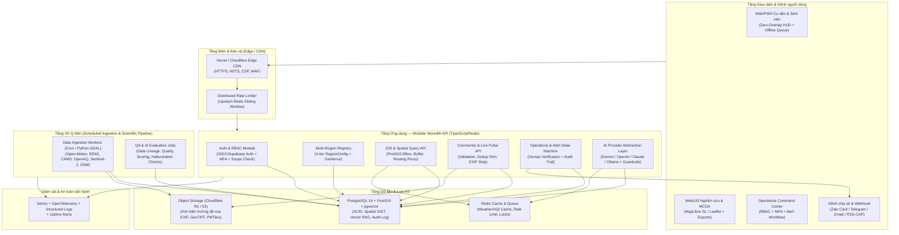

# KIẾN TRÚC HỆ THỐNG MỤC TIÊU (TARGET SYSTEM ARCHITECTURE)

## 1. Lựa chọn phong cách kiến trúc: Modular Monolith + API-First (Không dùng Microservices sớm)

Đối chiếu quy mô đội ngũ, ngân sách mở rộng từng bước và yêu cầu độ tin cậy cao khi ứng phó thiên tai, nền tảng chọn **Modular Monolith (Khối đơn thể phân mô-đun rõ ràng) kết hợp API-First và Background Workers độc lập** (xem [ADR-001](file:///C:/Users/TIEN%20PC/.gemini/antigravity/scratch/hanoi-flood-gis/docs/ARCHITECTURE_DECISIONS/ADR-001-modular-monolith-over-microservices.md)):

- **Vì sao KHÔNG chọn Microservices ngay:** Microservices làm tăng đột biến chi phí vận hành (service mesh, distributed tracing, giao dịch phân tán, độ trễ mạng nội bộ) trong khi một đội ngũ nhỏ hoàn toàn có thể vận hành 100.000+ người dùng/tháng trên một Modular Monolith chạy trên PostgreSQL + PostGIS + Redis với biên giới domain nghiêm ngặt.
- **Khả năng tách dịch vụ khi cần:** Các mô-đun cốt lõi (`regions`, `gis`, `data-ingestion`, `ai-intelligence`, `community`, `operations`, `security`) giao tiếp qua interface chuẩn; riêng tác vụ nặng (xử lý raster GeoTIFF/GDAL, đồng bộ vệ tinh Sentinel, batch eval AI) chạy ở **Background Worker** riêng (Python/Node container) để không làm chậm API người dùng.

---

## 2. Sơ đồ kiến trúc tổng thể



---

## 3. Phân rã cấu trúc mã nguồn mục tiêu (Migration Path không phá vỡ sản phẩm cũ)

Để đảm bảo nhánh production hiện tại luôn hoạt động 100% trong suốt quá trình tiến hóa, kiến trúc mới được dựng theo mẫu **Strangler Fig (Dựng lõi mới song song → cắm dần vào API/UI → thay thế hoàn toàn tệp nguyên khối cũ)**:

```text
hanoi-flood-gis/
├── platform/                      # Lõi nền tảng mới (Milestone 1 — Đang xây dựng)
│   ├── regions/                   # Multi-Region Registry (4 cấp + factory)
│   ├── data/                      # 6-class Provenance taxonomy + 12-field Metadata validator
│   ├── ai/                        # Provider-Agnostic AI Router + Scientific Guardrails
│   ├── security/                  # 5-role RBAC matrix + Magic-byte/XSS/Rate-limit validators
│   └── operations/                # Incident & Alert Workflow State Machine
├── api/                           # Serverless API endpoints (từng bước ủy quyền về platform/)
├── db/                            # (Milestone 2) PostgreSQL + PostGIS migrations & schema SQL
├── workers/                       # (Milestone 3–4) Data ingestion (Open-Meteo, OpenAQ, GDAL/Raster)
├── apps/                          # (Milestone 5) TypeScript Frontend modules tách từ app.js 207KB
├── tests/                         # Bộ test tự động đa tầng (Unit, Security, API, E2E)
├── docs/                          # 13 tài liệu kiến trúc/vận hành + ARCHITECTURE_DECISIONS (ADRs)
└── legacy/                        # (Milestone 2) Lưu trữ các script Google Apps Script đã ngừng dùng
```

---

## 4. Hợp đồng API (API-First Contract Principles)

Mọi API phiên bản `v2` (`/api/v2/...`) phải tuân thủ:
1. **Phân vùng tường minh:** Mọi truy vấn dữ liệu không gian nhận `regionId` (mặc định phân giải từ tọa độ hoặc header, không mặc định hardcode Đông Ngạc ở tầng logic lõi).
2. **Phân trang & truy vấn khung nhìn (Viewport BBox):** Thay vì trả toàn bộ hàng nghìn điểm cùng lúc như `GET /api/community` hiện tại (`1.750 ms`), API hỗ trợ `?bbox=minLng,minLat,maxLng,maxLat&zoom=14&hazard=flood&dataClass=OBSERVED,COMMUNITY&limit=200`.
3. **Envelope trả về chuẩn hóa có Provenance:**
   ```json
   {
     "ok": true,
     "meta": {
       "regionId": "vn-hn-dong-ngac-humg",
       "generatedAt": "2026-11-27T14:45:00Z",
       "dataClassesPresent": ["OBSERVED_DATA", "COMMUNITY_REPORTS"],
       "cacheStatus": "HIT"
     },
     "data": []
   }
   ```
4. **Idempotency & Concurrency:** Mọi yêu cầu tạo báo cáo/check-in chấp nhận header `Idempotency-Key` để hàng đợi offline PWA đồng bộ lại an toàn mà không sinh bản ghi trùng.

---

## 5. Ngân sách hiệu năng & Độ sẵn sàng mục tiêu (SLOs)

| Chỉ số | Hiện trạng Production (27/11/2026) | Mục tiêu Giai đoạn Pilot (M2–M4) | Mục tiêu Giai đoạn Thành phố (M7–M9) |
|---|---:|---:|---:|
| `GET /` (TTFB CDN) | `258 ms` | `< 200 ms` | `< 150 ms` |
| `GET /api/community` (Spatial Query) | `1.750 ms` (Blob scan) | `< 180 ms` (PostGIS + Redis) | `< 120 ms` (P95) |
| `POST /api/ai-copilot` (First token / Full) | `952 ms` (health) / `2–4s` | `< 2.5s` (Streaming SSE) | `< 1.8s` (Streaming + Cache) |
| Khả dụng dịch vụ (Availability) | Chưa đo tự động | `99.5%` | `99.9%` (có failover chế độ tĩnh) |
| Mất dữ liệu khi đồng thời ghi lúc mưa bão | Rủi ro cao (JSON overwrite) | `0` (PostgreSQL ACID) | `0` (ACID + Point-in-Time Recovery) |
