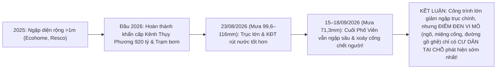

# Hồ Sơ Số Liệu Thực Tế & Trích Dẫn Báo Chí Về Ngập Úng Trong Bán Kính 2 km Quanh ĐH Mỏ - Địa Chất

> [!NOTE]
> **Tâm khảo sát:** Trường Đại học Mỏ - Địa chất Khu A (`18 Phố Viên, Phường Đông Ngạc mới, TP. Hà Nội` · `21.072514°N, 105.773870°E` · `UTM 48N: 580390.3 E, 2330368.2 N`).
> Toàn bộ khoảng cách dưới đây được tính bằng khoảng cách trắc địa từ tâm trường; cao độ lấy từ **Copernicus DEM GLO-30**; lượng mưa đối chiếu từ **ECMWF ERA5 (Open-Meteo)** và trạm đo báo chí công bố.

---

## 1. Danh Mục 12 Tuyến Phố / Điểm Nóng Ngập & Thủy Văn Thực Tế Nằm Trọn Trong Vòng ≤ 2.000 m

| STT | Địa điểm / Tuyến phố (Mã OSM) | Cách ĐH Mỏ | DEM GLO-30 | Mốc sự kiện & Trích dẫn báo chí chính thống | Thực trạng thực tế ghi nhận được |
| :---: | :--- | :---: | :---: | :--- | :--- |
| **1** | **Cầu Phố Viên – Bờ Tây sông Nhuệ** (`21.071680, 105.771249`) | **287 m** | `12 m` | *Hà Nội Mới, Kinh tế & Đô thị (2024–2025)* | Nút giao sát bờ sông Nhuệ; khi mực nước sông Nhuệ dâng báo động II–III trong mưa bão, khả năng tiêu thoát tự chảy bị chặn ngược (“hiệu ứng cổ chai”). |
| **2** | **Đoạn cuối Phố Viên (giáp ranh Đông Ngạc – Thượng Cát)** (`21.069413, 105.772544`) | **372 m** | `12 m` | **Báo Lao Động (18/09/2026):** *"Người dân mong xử lý dứt điểm úng ngập cuối phố Viên, Hà Nội"* · **Báo Đại Đoàn Kết (09/2026)** | Sau trận mưa giữa tháng 9/2026 (ERA5 ngày 15/09: `71,3 mm`), đoạn đường ngập sâu, mặt đường gồ ghề nhiều ổ gà, nước đọng lâu không rút hết; xuất hiện hố xoáy miệng cống gây tai nạn thương tâm với một nam sinh viên năm nhất ĐH Mỏ - Địa chất; người dân và sinh viên phải quay đầu đi vòng. |
| **3** | **Ngõ 521 & Cụm ngõ dân sinh Cổ Nhuế (Ngõ 401 – 487)** (`osm:way/699218408`, `21.068619, 105.776973`) | **540 m** | `11 m` | **Báo Dân Việt (2025)** — phản ánh ngập ngõ sâu phường Cổ Nhuế | Mạng lưới ngõ nhỏ mật độ nhà trọ sinh viên cao, hệ thống cống chưa đồng bộ; ngập cục bộ trong các trận mưa lớn năm 2025 (mức ngập báo chí nêu phổ biến ở các ngõ trũng Cổ Nhuế khoảng `20–40 cm`), thoát nước phụ thuộc vận hành trạm bơm Cổ Nhuế. |
| **4** | **Vùng trũng nhà trọ ven sông Nhuệ – Học viện Tài chính** (`osm:way/1198891357`, `21.079688, 105.779640`) | **995 m** | `10 m` | **Thông báo khẩn Học viện Tài chính (10/09/2024)** · **VnExpress, Đại Đoàn Kết, CafeF (09/2024)** | Hoàn lưu bão số 3 Yagi (ERA5 07/09/2024: `121,9 mm`) khiến lũ sông Nhuệ dâng cao; Học viện Tài chính phát thông báo khẩn rà soát sinh viên ngoại trú vùng trũng ven sông Nhuệ và mở các **Hội trường A8, A9, A10, A11 (58 Lê Văn Hiến)** làm điểm tránh trú miễn phí. |
| **5** | **Khu vực thi công đường Tây Thăng Long qua sông Nhuệ – Cổ Nhuế** (`osm:way/1434617049`, `21.062764, 105.769676`) | **1.168 m** | **`7 m`** | **Báo Sức khỏe & Đời sống, VietnamPlus, VOV (2025–2026)** | Cao độ rất thấp (`7 m`), nằm trong hành lang thi công dự án đường Tây Thăng Long (`>3,2 km`, rộng `60,5 m` – 10 làn xe) và cầu qua sông Nhuệ; quá trình giải phóng mặt bằng và thi công cống ngầm chưa đồng bộ dễ đọng nước bùn lầy cục bộ. |
| **6** | **Khu vực Cầu Noi – Đường Cổ Nhuế (ven sông Nhuệ)** (`21.061634, 105.772358`) | **1.220 m** | `12 m` | **Hà Nội Mới, Thanh Tra, VietnamPlus (2024–2026)** | Nút thắt giao thông và tiêu thoát nước ven sông Nhuệ; ngập sâu kèm ùn tắc kéo dài mỗi khi mưa lớn trùng đỉnh lũ sông Nhuệ. |
| **7** | **Khu đô thị Resco Cổ Nhuế (Cụm tòa OCT1, OCT2)** (`21.073800, 105.785800`) | **1.246 m** | `12 m` | **Danh sách điểm đen úng ngập Công ty Thoát nước HN** · **Tuổi Trẻ, VOV Giao thông, Báo Tin Tức (2025–2026)** | Cốt nền nội khu thấp hơn trục đường Phạm Văn Đồng sau nâng cấp; ngập nặng diện rộng các đợt bão tháng 8 và 9–10/2025. Đến mùa mưa 2026 đã giảm rõ thời gian ngập nhờ công trình khẩn cấp kênh Thụy Phương. |
| **8** | **Trục đường Phạm Văn Đồng (đoạn Cổ Nhuế – Công viên Hòa Bình)** (`21.064249, 105.784295`) | **1.422 m** | `12 m` | **Thư viện Pháp luật / Danh sách điểm ngập HN, Báo Tin Tức (2025–2026)** · **ECMWF ERA5 (2024–2026)** | Điểm đọng nước cục bộ giờ cao điểm khi mưa dồn dập (mức thường ghi nhận khoảng `15–30 cm` tại các điểm trũng mặt đường), đồng thời là trục bê tông nhựa rộng nhiều làn hấp nhiệt mạnh vào các ngày nắng gắt (`63–76` ngày nhiệt cảm nhận $\ge 40^\circ\text{C}$/năm). |
| **9** | **Tuyến Kênh Thụy Phương – Đường Kẻ Vẽ & Hoàng Tăng Bí** (`osm:way/1530168567`, `way/615692227`, `21.085283, 105.778152`) | **1.375 – 1.488 m** | `13 – 16 m` | **Quyết định số 5520/QĐ-UBND (10/11/2025)** · **VnExpress, CafeF, HĐND TP. Hà Nội `dbndhanoi.gov.vn` (02–08/2026)** | Tuyến tiêu thoát trọng điểm thuộc **Dự án công trình khẩn cấp hơn 920 tỷ đồng (`920,6 tỷ`)** cải tạo `>3,5 km` kênh hở + `~4 km` cống hộp ngầm kết nối sông Tô Lịch, giải cứu ngập cho Resco – Ecohome – Đông Ngạc. Báo VnExpress cũng phản ánh tình trạng sụt lún, nứt cục bộ một số nhà dân dọc tuyến thi công (đang xử lý đền bù). |
| **10** | **Đường Tân Nhuệ (điểm trũng nhất trong bán kính 2 km)** (`osm:way/146724866`, `21.086397, 105.771402`) | **1.565 m** | **`6 m`** | **VietnamPlus, Báo Lao Động (2025–2026)** | Cao độ chỉ **`6 m`** — điểm trũng thấp nhất đo được trong vòng 2 km quanh trường; là vị trí đặt cống nối qua đường Tân Nhuệ phục vụ thoát nước cho tiểu lưu vực Đông Ngạc – Cổ Nhuế, từng ngập cục bộ trong giai đoạn rào chắn thi công. |
| **11** | **Cụm chung cư Ecohome 1, Ecohome 2, Ecohome 3 (Đường Đông Thắng)** (`osm:node/12117023198`, `12117023197`, `way/37765862`, `21.084909, 105.784291`) | **1.597 – 1.800 m** | **`9 – 10 m`** | • **VietNamNet (26/08/2025):** *"Chung cư ở Hà Nội thành 'ốc đảo' sau mưa lớn, loạt ô tô dưới hầm bị nước bủa vây"* • **Dân Trí (27/08/2025):** *"Chung cư Hà Nội ngập sâu, mất điện: Dân tát nước ở thang máy, nhờ chi viện"* • **VietNamNet (27/08/2025):** *"Dân chung cư Hà Nội leo bộ 9 tầng, lội nước mang nồi cơm điện đi cắm nhờ"* • **VietNamNet (02/10/2025):** *"Cư dân Hà Nội chung tay dọn dẹp sau 48 giờ chống chọi ngập nặng"* • **Báo Mới / Hà Nội Mới (23/08/2026):** cập nhật bão số 4 | **Năm 2025:** Lối vào và đường nội khu ngập **`1 m – 1,4 m`** (đoạn cổng rào gần trường học sâu tới `1,4 m`), nước tràn sảnh tầng 1 sâu `60 cm – ~1 m` làm tê liệt toàn bộ **16 thang máy tại 4 tòa Ecohome 1**, mất điện, cắt nước nhiều ngày, cư dân phải dựng đập bao cát chắn hầm và dùng thuyền phao tiếp tế. **Năm 2026 (23/08/2026):** Dù Đông Ngạc mưa đo đạt **`99,6 mm`** (ERA5: `116 mm`), tình trạng ngập sâu kéo dài đã giảm rõ nhờ thông tuyến kênh Thụy Phương và vận hành trạm bơm đầu mối. |
| **12** | **Đường Phạm Văn Nghị – Khu B ĐH Mỏ - Địa chất (Bờ Tây sông Nhuệ)** (`osm:way/965882635`, `way/1294976834`, `21.067813, 105.757184`) | **1.370 – 1.808 m** | **`8 – 10 m`** | **OpenStreetMap & Dữ liệu DEM lưu vực sông Nhuệ** | Nằm hoàn toàn ở bờ Tây sông Nhuệ trên dải nền thấp `8 – 10 m` DSM; cần khảo sát trực tiếp sinh viên Khu B và Học viện Cảnh sát nhân dân về các điểm đọng nước và nắng gắt dọc tuyến nối Khu A – Khu B. |

---

## 2. Công Trình Thủy Lợi Đầu Mối Nằm Ngay Ngoài Rìa 2 km (Tác Động Trực Tiếp Toàn Vùng)

Trong báo cáo chuyên môn của sinh viên ĐH Mỏ - Địa chất, cần phân tách rõ hai công trình đầu mối dưới đây nằm **ngoài vòng 2,0 km** nhưng quyết định trực tiếp tốc độ rút nước của cả vùng 2 km:

1. **Trạm bơm Thụy Phương (`công suất thiết kế 5 m³/s`, 4 tổ máy — cách sông Hồng ~300 m, đoạn trục đường Thụy Phương cách trường `~2,3 km`):** Công trình đầu mối khởi điểm của tuyến kênh Thụy Phương `920,6 tỷ đồng`, cơ bản hoàn thành lắp đặt giữa năm 2026 (*VnExpress, Lao Động, HĐND TP. Hà Nội*).
2. **Trạm bơm Cổ Nhuế (`công suất ~12 m³/s`, 4 tổ máy — báo Tiền Phong, Dân Việt):** Đóng vai trò “lá chắn” cưỡng bức bơm nước mưa từ hệ thống cống gom ra sông Nhuệ khi mực nước sông ngoài dâng cao (kết hợp mở đập Thanh Liệt hạ mực nước đệm).

---

## 3. Phát Hiện Đáng Giá Nhất Cho Báo Cáo & Lý Do Cần “Web Mở Cư Dân Đánh Dấu”

- **Luận điểm cực mạnh cho thuyết trình cuối kỳ:** Dù thành phố đã đầu tư hơn `920 tỷ đồng` cải tạo kênh Thụy Phương giúp giảm ngập đáng kể cho cụm chung cư lớn trong bão số 4 tháng 8/2026, thực tế bi thảm tại **cuối Phố Viên tháng 9/2026** chứng minh các **điểm đen vi mô (ngõ thấp, mặt đường ổ gà, hố ga mất nắp tạo xoáy)** vẫn hiện hữu ngay sát cổng trường (`372 m`).
- Đó chính là lý do **Web Bản đồ Cộng đồng Mở** (nơi người dân sống trong vòng 2 km tự bấm `+1` và chấm ghim cảnh báo ngõ trọ/miệng cống ngay khi phát hiện) bổ sung chính xác khoảng trống mà các công trình lớn và app cấp thành phố chưa phủ tới!

---

## 4. Hồ Sơ Thực Tế Về Nắng Nóng Đô Thị (UHI), Phòng Trọ Mái Tôn & Tuyến Xe Buýt Quanh ĐH Mỏ (2024–2026)

Nhóm Đề tài 08 xử lý song hành cả hai rủi ro **Nắng nóng gay gắt** và **Mưa lớn / Ngập cục bộ**. Toàn bộ chứng cứ thực tế về nắng nóng và điểm chờ phương tiện công cộng trong bán kính ≤ 2 km đã được kiểm chứng từ cơ quan khí tượng, báo chí chính thống và OpenStreetMap:

### 4.1. Kỷ lục nắng nóng Hà Nội & Hiệu ứng Đảo nhiệt Đô thị (UHI)
- **Kỷ lục Trạm khí tượng Láng (Trung tâm Dự báo KTTV Quốc gia — *VnExpress, Báo Pháp Luật, VietNamNet*):** Ngày **`04/08/2025`**, Trạm Láng ghi nhận mức nhiệt kỷ lục lịch sử tháng 8 đạt **`40,3°C`**; sang các đợt nắng tháng 5–6/2026, nhiều ngày nội đô tiếp tục vượt ngưỡng **`40–41°C`** trong lều khí tượng.
- **Chênh lệch nhiệt độ cảm nhận ngoài trời (UHI):** Theo giải thích của cơ quan khí tượng trên *VnExpress / Báo Pháp Luật*, do hiệu ứng đảo nhiệt đô thị (bê tông nhựa, mật độ xe cộ, khí thải điều hòa), **nhiệt độ cảm nhận ngoài trời trên mặt đường nhựa cao hơn trong lều khí tượng từ `2–4°C` (thậm chí cao hơn nữa)** vào khung `11h00–15h30`. Số liệu **ECMWF ERA5** tại chính tọa độ ĐH Mỏ (`21.0725°N, 105.7739°E`) xác nhận có tới **`71` ngày (2024)**, **`63` ngày (2025)** và **`76` ngày (2026 tính đến 20/11)** có chỉ số nhiệt cảm nhận `≥ 40°C`.
- **Trục Phạm Văn Đồng thiếu tán cây lịch sử (*Báo Lao Động, Thanh Niên, Nhân Dân*):** Khi mở rộng Vành đai 3 (trục Phạm Văn Đồng giáp phía Đông bán kính 2 km), gần **`1.300` cây xanh** (gần `1.000` cây xà cừ cổ thụ) đã được đánh chuyển/chặt hạ, khiến khu vực đường rộng nhiều làn trở thành dẫn chứng điển hình về bức xạ nhiệt trực tiếp đối với người đi bộ, tài xế công nghệ và sinh viên đứng đợi xe buýt.

### 4.2. Thực trạng “Lò nung” Phòng trọ Mái tôn Sinh viên Hà Nội (*Lao Động, VTV, Dân Trí, VietnamPlus, CafeF*)
- Các phóng sự đo đạc thực tế mùa hè `2024–2026` tại các khu xóm trọ sinh viên Hà Nội (trong đó có cụm Cổ Nhuế – Đông Ngạc mật độ trọ dày đặc) ghi nhận khi ngoài trời `37–40°C`, **nhiệt độ bên trong phòng trọ lợp mái tôn / gác xép sát mái khung `11h00–16h00` vọt lên `45–50°C`**.
- Giá điện kinh doanh/nhà trọ phổ biến **`3.500–4.000 đ/kWh`** khiến nhiều sinh viên ngại bật điều hòa ban ngày, buộc phải chuyển sang **"sơ tán tránh nóng"** tại thư viện trường, giảng đường hoặc không gian công cộng có điều hòa/bóng mát.

### 4.3. Mạng lưới Tuyến xe buýt & Điểm chờ / Mặt nước Hạ nhiệt Xác thực OSM (≤ 2 km)

| Mã trên Web | Đối tượng thực tế (Mã OSM xác thực) | Cách ĐH Mỏ | DEM GLO-30 | Vai trò / Tuyến kết nối thực tế |
| :---: | :--- | :---: | :---: | :--- |
| **`R-14`** | **Điểm dừng xe buýt BV Đa khoa Phương Đông – Phố Viên** (`osm:node/11515782290`) | **`121 m`** | `13 m` | Điểm đón chính của sinh viên ĐH Mỏ với **3 tuyến buýt thực tế: `09A` (Trần Khánh Dư ⇄ ĐH Mỏ), `28` (BX Nước Ngầm ⇄ ĐH Mỏ) và `31` (Bách Khoa ⇄ ĐH Mỏ / Chèm)** (*TimBus, Thư viện Pháp luật, Tin Tức Việt Nam*). |
| **`R-13`** | **Điểm dừng xe buýt 138 Phạm Văn Đồng – Cầu vượt bộ hành** (`osm:node/7294677886`) | **`1.222 m`** | `12 m` | Trạm trung chuyển lớn sát KĐT Resco nằm trực tiếp trên trục Vành đai 3 nắng gắt; mức độ phơi nhiễm tia UV & bức xạ mặt đường cao khung `11h–15h`. |
| *(Tham chiếu OSM)* | **Điểm dừng 51 Hoàng Tăng Bí** (`osm:node/8954351040`, `1.487 m`, `13 m`) · **31 Tân Xuân** (`osm:node/8920049629`, `1.632 m`, `12 m`) · **Đường vào CV Hòa Bình** (`osm:node/8821681980`, `1.567 m`, `13 m`) | `1,48 – 1,63 km` | `12 – 13 m` | Các điểm dừng bổ trợ trên trục lộ trình tuyến `09A`, `28` kết nối khu dân cư Đông Ngạc – Ecohome – Cổ Nhuế. |
| **`S-08`** | **Hồ điều hòa Thụy Phương 2** (`osm:way/1555357769`, `21.066800, 105.769300`) | **`793 m`** | **`9 m`** | Vùng đệm mặt nước quy mô lớn nằm ngay giữa lòng máng địa hình; vừa tích trữ nước mưa điều tiết cho tiểu lưu vực vừa giúp giảm nhiệt vi khí hậu ngày nắng (chỉ hóng mát khi khô ráo, không đứng bờ hồ lúc mưa dông). |
